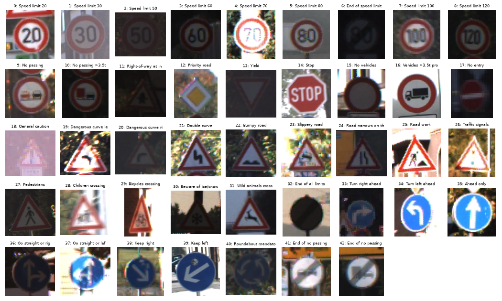
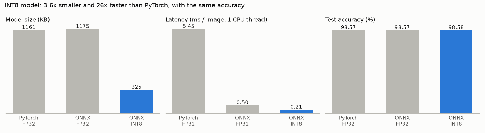
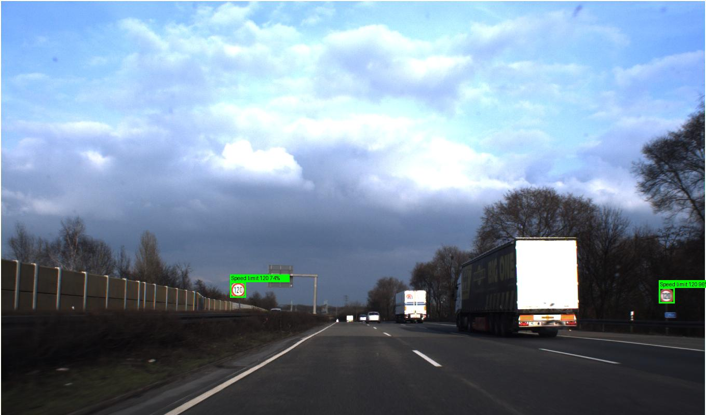

# 🚦 Traffic Sign Recognition & Detection: from training to deployment


Training a good classifier is the easy part. Car makers care about **size, speed and running without a big framework**. This project goes all the way from data to a standalone app: first a classifier for cropped signs, then a detector that finds the signs in a full road photo.

| Part | Data | Key result |
|---|---|---|
| [1. Classification](#1-classification-which-sign-is-it) | GTSRB, 43 classes, 39k images | **98.6%** test accuracy, INT8 model **3.6× smaller**, **0.21 ms** per image on 1 CPU thread |
| [2. Detection (YOLO)](#2-detection-where-are-the-signs-yolo) | GTSDB, 900 road photos | **99.2%** of signs found and correctly named, **95.7%** recall on tiny signs (< 24 px), runs with ONNX Runtime only |

📓 [`traffic_signs.ipynb`](traffic_signs.ipynb) · [`traffic_sign_detector.ipynb`](traffic_sign_detector.ipynb) · 📦 [`deploy/`](deploy/)

## 1. Classification: which sign is it?



### What I did

- **Leak-free validation split by track.** GTSRB films every real sign 30 times from a moving car. A random split puts almost identical photos in both train and validation, so I split by *physical sign* instead.
- **Augmentation that keeps the meaning:** small rotations, shifts and light changes, but **no horizontal flips**, because a flipped "Keep right" *is* "Keep left".
- **A small CNN** (293k parameters, 3 conv blocks + global average pooling) with label smoothing and a cosine learning-rate schedule.
- **Deployment pipeline:** PyTorch → **ONNX** → **INT8 static quantization** (calibrated on training images), measured like an embedded device: 1 CPU thread, batch size 1, with warm-up.
- **A standalone predictor** ([`deploy/predict_sign.py`](deploy/predict_sign.py)) that needs only `onnxruntime`, `numpy` and `Pillow`. The preprocessing settings are saved in `labels.json`, so the device does exactly the same steps as training.



| Version | Size | Latency (1 thread) | Test accuracy |
|---|---|---|---|
| PyTorch FP32 | 1161 KB | 5.45 ms | 98.57% |
| ONNX FP32 | 1175 KB | 0.50 ms | 98.57% |
| **ONNX INT8** | **325 KB** | **0.21 ms** | **98.58%** |

GTSRB images are already cropped around the sign, so a real car first needs a **detector** to find the signs in the camera frame. That's part 2.

## 2. Detection: where are the signs? (YOLO)

The classifier above needs a cropped sign. Part 2 finds the signs in a **whole 1360×800 camera frame** first, using a two-stage pipeline:

```
road photo ──► YOLO11n "where are the signs?" ──► crop (+10% border) ──► INT8 CNN "which sign?" ──► "Speed limit 120"
```



### What I did

- **Converted GTSDB** (German Traffic Sign Detection Benchmark) to YOLO format, including empty label files for photos with no sign, so the model also learns "nothing here".
- **Transfer learning:** fine-tuned YOLO11n (COCO-pretrained) as a 1-class "sign" detector for 50 epochs. The classifier from part 1 names the sign.
- **Small objects:** many signs are under 32 px wide. Training at **1024 px** instead of the default 640 keeps them visible. I measured recall **per sign size**, not only overall.
- **Framework-free deployment:** the detector is exported to ONNX. Letterboxing, box decoding and Non-Maximum Suppression are written in numpy, so the app ([`deploy/detect_signs.py`](deploy/detect_signs.py)) needs only `onnxruntime`, `numpy` and `Pillow`.

| Test set (300 unseen photos, 361 signs) | Result |
|---|---|
| Detector precision / recall | 0.975 / 0.978 |
| mAP50 / mAP50-95 | 0.989 / 0.863 |
| Recall, signs < 24 px · 24–32 px · > 32 px | 95.7% · 98.7% · 100% |
| End to end: found **and** correctly named | **358 / 361 (99.2%)**, 0 wrong names |
| Speed on a laptop CPU (1 · 4 threads) | 136 ms · 82 ms per frame |

## Limits & next steps

- The classifier scored 100% on the found signs, but GTSRB and GTSDB come from the same research group, so the photos look alike. Expect lower accuracy on another country's signs or cameras.
- End-to-end precision is 87.5% at confidence 0.25, so a real system would raise the threshold or confirm a sign over several frames.
- Latency was measured on a laptop CPU; the next step is measuring on a Raspberry Pi.

## Try the deployed models

No PyTorch needed:

```bash
pip install onnxruntime numpy pillow
python deploy/predict_sign.py path/to/sign.png                    # a cropped sign
python deploy/detect_signs.py path/to/road.jpg --out result.jpg   # a full road photo
```

## Run the notebook

```bash
git clone https://github.com/muemara1/traffic-sign-recognition.git
cd traffic-sign-recognition
python -m venv .venv
# Windows: .venv\Scripts\activate    Linux/macOS: source .venv/bin/activate

# For an NVIDIA GPU, install the CUDA build of torch first (see pytorch.org)
pip install -r requirements.txt
jupyter notebook
```

**Data** (not stored in the repo):

| Notebook | Where to get it | Put it in |
|---|---|---|
| `traffic_signs.ipynb` | downloaded automatically by `torchvision.datasets.GTSRB` | `data/gtsrb/` |
| `traffic_sign_detector.ipynb` | [GTSDB](https://benchmark.ini.rub.de/gtsdb_dataset.html), `FullIJCNN2013.zip` | `data/gtsdb/FullIJCNN2013/` |

> **AMD GPU note:** on ROCm under Windows, MIOpen may fail to compile its BatchNorm kernel.
> The notebook sets `torch.backends.cudnn.enabled = False` to use PyTorch's built-in kernels instead.

## Credits

- **Datasets:** [GTSRB](https://benchmark.ini.rub.de/gtsrb_dataset.html) and [GTSDB](https://benchmark.ini.rub.de/gtsdb_dataset.html), Ruhr-Universität Bochum.
- **YOLO11:** [Ultralytics](https://github.com/ultralytics/ultralytics) (AGPL-3.0).

---

More of my work: [github.com/muemara1](https://github.com/muemara1)
